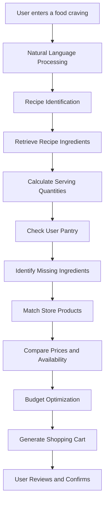
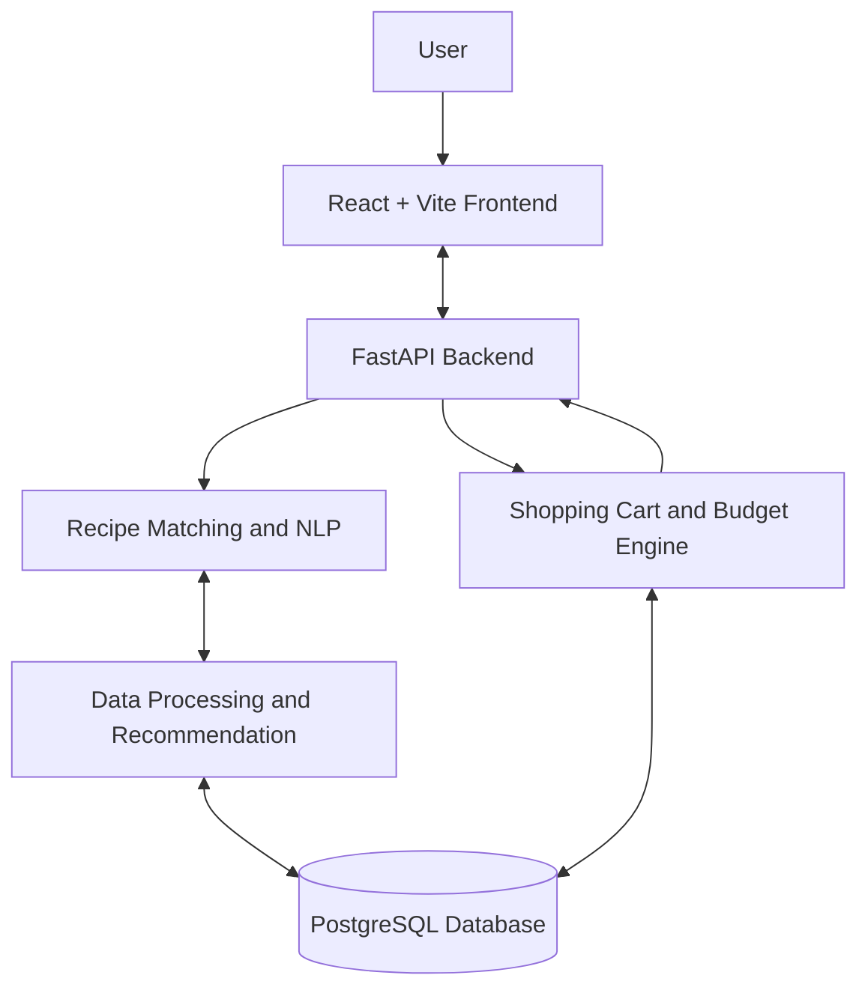

# 🛒 SILLA
### From Cravings to Cart.

<p align="center">
  <strong>Turn your food cravings into a smart, personalized shopping cart.</strong>
</p>

<p align="center">
  An AI-powered recipe-to-cart recommendation platform that transforms natural-language food requests into optimized grocery shopping lists.
</p>

<p align="center">
  
  
  
  
</p>

---

## 🌿 About SILLA

**SILLA** is an intelligent, AI-powered web application designed to simplify meal planning and grocery shopping.

Instead of manually searching for recipes, calculating ingredient quantities, checking kitchen supplies, and comparing product prices, users can simply describe what they want to cook.

SILLA processes their request, identifies the appropriate recipe, calculates the required ingredients, checks what they already have at home, and generates a personalized shopping cart containing the missing items.

By combining **Natural Language Processing (NLP), Data Science, Recommendation Systems, and Budget Optimization**, SILLA creates a smarter and more convenient cooking and shopping experience.

### 💡 The Problem

Preparing a meal often involves several separate tasks:

- Finding a suitable recipe.
- Identifying all required ingredients.
- Calculating quantities based on the number of servings.
- Checking ingredients already available at home.
- Searching for suitable supermarket products.
- Comparing prices and staying within budget.

These tasks can be time-consuming and inconvenient.

### 🚀 Our Solution

SILLA connects the entire process into one intelligent workflow:

**Food Craving → Recipe Discovery → Ingredient Analysis → Pantry Check → Product Matching → Smart Shopping Cart**

Our goal is to make meal planning easier, grocery shopping smarter, and food budgeting more efficient.

---

## ✨ Key Features

### 🔎 1. Smart Recipe Discovery
- Search for dishes using natural language.
- Support Arabic and English food requests.
- Identify relevant recipes using intelligent matching.
- Explore different food categories and recommendations.

### 🧠 2. AI-Powered Recipe Matching
- Understand user food requests.
- Match requests with recipes from the database.
- Support multilingual ingredient and dish names.
- Recommend relevant recipes based on user preferences.

### 🥗 3. Intelligent Ingredient Calculation
- Retrieve ingredients and their quantities.
- Automatically adjust quantities according to serving size.
- Standardize ingredient names and measurement units.
- Prevent duplicate ingredient entries.

### 🏠 4. Smart Pantry Management
- Allow users to indicate ingredients already available at home.
- Compare pantry inventory with recipe requirements.
- Calculate missing ingredient quantities.
- Avoid unnecessary purchases.

### 🛍️ 5. Automated Shopping Cart
- Match recipe ingredients with supermarket products.
- Display product names, package sizes, and prices.
- Calculate required purchase quantities.
- Allow users to edit quantities and remove products.
- Generate a complete shopping list automatically.

### 💰 6. Budget-Aware Shopping
- Allow users to specify a shopping budget.
- Compare available product prices.
- Recommend suitable alternatives.
- Estimate total shopping costs.
- Identify when a budget cannot accommodate all required products.

### ⭐ 7. Personalized Recommendations

Planned advanced capabilities include:

- Recipe recommendations based on user preferences.
- Budget-based meal suggestions.
- Dietary preference filtering.
- Multi-recipe meal planning.
- Combined shopping lists across multiple recipes.

---

## 🎯 Example: From Craving to Cart

Imagine a user enters:

> "I want to make macaroni béchamel for four people, and my budget is 300 EGP."

SILLA processes the request and generates the following workflow:

| Step | System Action |
|---|---|
| 1 | Identifies macaroni béchamel |
| 2 | Retrieves the matching recipe |
| 3 | Calculates ingredient quantities for four people |
| 4 | Checks the user's pantry |
| 5 | Identifies missing ingredients |
| 6 | Matches ingredients to supermarket products |
| 7 | Compares prices and package sizes |
| 8 | Generates an editable shopping cart |

**Example shopping cart:**

| Product | Required quantity | Example price |
|---|---:|---:|
| Macaroni | 500 g | 30 EGP |
| Minced meat | 500 g | 180 EGP |
| Milk | 1 litre | 40 EGP |
| Flour | 100 g | 8 EGP |
| Butter | 100 g | 35 EGP |
| Mozzarella | 200 g | 75 EGP |

*All quantities and prices above are illustrative. Actual cart contents depend on the recipe, pantry inventory, product catalog, and package sizes.*

---

## ⚙️ How SILLA Works



---

## 🧠 Data Science and AI Components

SILLA is designed as more than a traditional recipe website. Its intelligence comes from multiple data-driven components.

| Component | Purpose |
|---|---|
| Natural Language Processing | Understand natural-language food requests |
| Semantic Similarity | Match user requests with relevant recipes |
| Recipe Recommendation | Suggest suitable meals based on user preferences |
| Data Preprocessing | Clean and normalize recipe and ingredient data |
| Ingredient Matching | Connect recipe ingredients with store products |
| Quantity Calculation | Scale recipe ingredients based on serving size |
| Budget Optimization | Select suitable product packages within budget constraints |
| Predictive Analytics | Explore ingredient demand, meal popularity, and price trends |

### Evaluation Metrics

We plan to evaluate the intelligent components using:

- Recipe matching: Top-1 and Top-3 accuracy.
- Ingredient matching: Precision and recall.
- Quantity calculations: Calculation accuracy.
- Cart generation: Correct purchase quantities and total prices.
- Budget optimization: Percentage of feasible carts meeting the budget.
- User experience: Task completion rate and user feedback.

---

## 🛠️ Technology Stack

### Frontend

| Technology | Purpose |
|---|---|
| React.js | Build the interactive website |
| Vite | Frontend development and build tooling |
| CSS | Responsive styling and visual design |

### Backend

| Technology | Purpose |
|---|---|
| Python | Core backend and data science logic |
| FastAPI | REST API development |
| Pydantic | Data validation and request schemas |

### Data Science and Machine Learning

| Technology | Purpose |
|---|---|
| Pandas | Data manipulation and analysis |
| NumPy | Numerical calculations |
| Scikit-learn | Recommendation and machine learning algorithms |
| Sentence Transformers | Optional multilingual semantic matching |
| Jupyter Notebook | Exploratory data analysis and experimentation |

### Database and Development Tools

| Technology | Purpose |
|---|---|
| PostgreSQL | Persistent application database |
| SQLite | Lightweight development database |
| Git & GitHub | Version control and collaboration |
| Figma | UI/UX design and prototyping |
| Postman | API testing |
| Pytest | Backend testing |

---

## 🏗️ System Architecture

SILLA follows a modular client-server architecture.



### Main System Modules

1. **Frontend Module:** Handles user interactions and website presentation.
2. **Recipe Module:** Retrieves and matches recipes.
3. **Data Science Module:** Processes requests and generates recommendations.
4. **Ingredient Module:** Calculates quantities and handles pantry subtraction.
5. **Product Module:** Matches ingredients with available products.
6. **Cart Module:** Calculates purchase quantities and shopping costs.
7. **Database Module:** Stores recipes, ingredients, products, and user information.

---

## 📂 Project Structure

```text
SILLA/
│
├── frontend/
│   ├── public/
│   │   ├── images/
│   │   └── assets/
│   │
│   ├── src/
│   │   ├── components/
│   │   ├── pages/
│   │   ├── services/
│   │   ├── hooks/
│   │   ├── context/
│   │   ├── styles/
│   │   └── App.jsx
│   │
│   └── package.json
│
├── backend/
│   ├── app/
│   │   ├── api/
│   │   ├── models/
│   │   ├── schemas/
│   │   ├── services/
│   │   ├── database/
│   │   └── main.py
│   │
│   ├── tests/
│   └── requirements.txt
│
├── data/
│   ├── recipes/
│   ├── ingredients/
│   └── products/
│
├── notebooks/
│   ├── exploratory_data_analysis.ipynb
│   ├── recipe_matching.ipynb
│   └── recommendation_experiments.ipynb
│
├── docs/
│   ├── requirements.md
│   ├── architecture.md
│   ├── data_dictionary.md
│   ├── api_specification.md
│   └── testing.md
│
├── .gitignore
├── .env.example
└── README.md
```

---

## 🚀 Getting Started

The following instructions describe the intended development setup.

### Prerequisites

Install the following:

- Node.js and npm.
- Python 3.10+.
- Git.
- PostgreSQL (if using PostgreSQL).

### 1. Clone the Repository

```bash
git clone https://github.com/YOUR-USERNAME/SILLA.git

cd SILLA
```

### 2. Run the Frontend

```bash
cd frontend

npm install

npm run dev
```

The development server will provide a local URL, usually:

```text
http://localhost:5173
```

### 3. Run the Backend

Open another terminal:

```bash
cd backend

python -m venv venv
```

Activate the virtual environment.

**Windows:**

```bash
venv\Scripts\activate
```

**macOS / Linux:**

```bash
source venv/bin/activate
```

Install dependencies:

```bash
pip install -r requirements.txt
```

Start the FastAPI development server:

```bash
uvicorn app.main:app --reload
```

The API will usually be available at:

```text
http://127.0.0.1:8000
```

Interactive API documentation:

```text
http://127.0.0.1:8000/docs
```

*These commands assume the corresponding project files and dependencies have been implemented.*

---

## 📊 Dataset

The initial version will use a curated dataset containing recipes, ingredients, and supermarket products.

### Recipe Dataset

| Column | Description |
|---|---|
| recipe_id | Unique recipe identifier |
| name_en | English recipe name |
| name_ar | Arabic recipe name |
| servings | Default number of servings |
| instructions | Preparation instructions |
| dietary_tags | Dietary information |

### Ingredient Dataset

| Column | Description |
|---|---|
| ingredient_id | Unique ingredient identifier |
| recipe_id | Associated recipe |
| ingredient_name | Ingredient name |
| quantity | Required amount |
| unit | Measurement unit |
| category | Ingredient category |

### Product Dataset

| Column | Description |
|---|---|
| product_id | Unique product identifier |
| product_name | Store product name |
| ingredient_id | Associated ingredient |
| brand | Product brand |
| package_size | Product package quantity |
| price | Product price |
| currency | Price currency |
| availability | Stock status |

Future datasets may include user preferences, pantry inventories, purchase history, nutritional information, and historical product prices.

---

## 🇪🇬 Egyptian Food Intelligence

One of SILLA's main directions is supporting Egyptian cuisine and local food terminology.

Example dishes include:

- Macaroni béchamel — مكرونة بشاميل
- Koshari — كشري
- Molokhia — ملوخية
- Mahshi — محشي
- Hawawshi — حواوشي
- Fattah — فتة

The platform aims to support Arabic and English food requests, including common Egyptian expressions.

---

## 👥 Team & Responsibilities

SILLA is developed by a team of five members.

| Team Member | Responsibility |
|---|---|
| Member 1 | Data Science, NLP, and Recommendation Systems |
| Member 2 | Dataset Collection, Data Engineering, and Database |
| Member 3 | Backend Development and Shopping Cart Logic |
| Member 4 | UI/UX Design and Frontend Development |
| Member 5 | System Integration, Testing, Documentation, and Deployment |

All members collaborate through a shared GitHub repository and coordinated development workflow.

---

## 🗺️ Development Roadmap

- [ ] Project planning and requirements analysis
- [ ] Recipe and product dataset collection
- [ ] Database design and implementation
- [ ] UI/UX design using Figma
- [ ] Frontend development using React
- [ ] Backend development using FastAPI
- [ ] Natural-language recipe matching
- [ ] Ingredient quantity calculation
- [ ] Pantry management
- [ ] Product matching
- [ ] Automated shopping cart generation
- [ ] Budget-aware product selection
- [ ] Frontend and backend integration
- [ ] Testing and evaluation
- [ ] Website deployment
- [ ] Final documentation and presentation

---

## 🔮 Future Enhancements

SILLA has the potential to evolve into a complete intelligent food-shopping ecosystem.

Future improvements may include:

- Real-time supermarket product integrations.
- Live price and stock updates.
- Personalized meal recommendations.
- Multi-recipe shopping cart optimization.
- Advanced dietary and nutritional recommendations.
- Price prediction and ingredient demand forecasting.
- User purchase history and preference learning.
- Online checkout integrations.
- Voice-based food requests.

---

## 🎨 Brand Identity

**Project Name:** SILLA

**Tagline:** From Cravings to Cart.

**Brand Colors:**

| Color | Hex Code | Usage |
|---|---|---|
| Forest Green | `#244A3A` | Primary brand color |
| Honey Gold | `#E5A84B` | Highlights and accents |
| Cream | `#F7F3E9` | Backgrounds |
| Sage | `#E7E9D5` | Secondary surfaces |
| Charcoal | `#30342F` | Text and contrast |

The visual identity represents freshness, convenience, intelligent technology, and affordable shopping.

---

## 🤝 Contributing

We welcome collaboration and suggestions.

For team contributions:

1. Clone the repository.
2. Create a feature branch.
3. Implement your assigned feature.
4. Test your changes.
5. Commit and push your work.
6. Open a Pull Request for review.

Suggested branch naming:

```text
feature/recipe-search
feature/ingredient-matching
feature/shopping-cart
feature/budget-optimization
feature/user-interface
```

---

## 📌 Project Status

**Current Status: In Development**

SILLA is being developed as a data science and web development project.

The initial objective is to deliver a functional MVP demonstrating recipe identification, ingredient calculation, pantry awareness, product matching, and automated shopping cart generation.

Product prices and availability may initially use sample data. Live supermarket integration and payment processing are considered future enhancements.

---

## ❤️ Our Vision

We believe grocery shopping should start with what people want to eat, not with a long list of ingredients they have to figure out themselves.

SILLA connects food discovery, intelligent recommendations, and smart shopping into one seamless experience.

**Less planning. Smarter shopping. More time enjoying what you love.**

<p align="center">
  <strong>SILLA — From Cravings to Cart. 🛒</strong>
</p>
