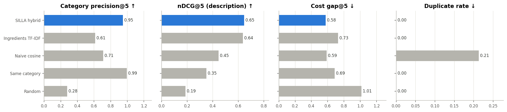

# SILLA — Data Science & Recommendation: Evaluation Report

**Owner:** Amr Badr (Data Science & Recommendation) · **Data:** `SILLA_Data_Engineering/database/silla_staging.db`
**Reproduce:** `python -m SILLA_Data_Science.evaluation` · `python -m SILLA_Data_Science.cost_model` · notebooks in `SILLA_Data_Science/notebooks/`

> **ملخص بالعربي:** تم تحليل البيانات (EDA)، وبناء نظام توصيات قائم على المحتوى يقترح وصفات مشابهة وبديلة حسب المكونات والتكلفة والتفضيلات (نظام غذائي، مكونات مستبعدة، ميزانية، وقت، المكونات الموجودة في البيت). النظام تفوّق على كل النماذج المرجعية: 95% من الاقتراحات من نفس نوع الطبق، وأفضل ترتيب (nDCG = 0.65 مقابل 0.19 للعشوائي)، وصفر اقتراحات مكررة، والالتزام بقيود المستخدم 100%. البدائل الأرخص بتوفر في المتوسط 47% من تكلفة الفرد. نموذج توقع التكلفة (Gradient Boosting) وصل لـ R² ≈ 0.76 بخطأ متوسط ≈ 12.6 جنيه للفرد، وده أحسن من النموذج المرجعي لكنه لسه تقديري بسبب صغر حجم البيانات (155 طبق).

---

## 1. Data findings that shaped the design

| Finding | Impact | What was done |
|---|---|---|
| 320 recipes = **155 unique dishes**; 165 are style variants (e.g. *Koshari (Cairo Street Style)*) with **identical ingredients and quantities** | Naive similarity recommends the same dish under another name; models leak between train/test | Recipes grouped into families; variants are never recommended for each other; models trained on unique dishes |
| Only **98/140 ingredients** have a product; only 6 dishes are 100% priced | Raw costs under-estimate dishes using milk, oil, herbs, some meats/fish | Missing ingredient cost **imputed** from the median price/g of its ingredient category (≈ 33% of total estimated cost) |
| Shared `CostCalculator` converts *piece → g* with a 100 g default (its produce table uses old ingredient IDs) | 4 cardamom pods = 400 g ≈ 600 EGP; **76 recipes over-priced, up to ≈ 1,427 EGP** | Realistic per-piece weights applied in `data_loader.py` (no change to the shared module). **Action for the module owner:** fix `PRODUCE_PIECE_WEIGHT_G` IDs and add spice/egg piece weights |
| `gluten-free` tag only present on vegan ingredients | Recipe-level gluten-free flag would be wrong | Only vegan / vegetarian / pescatarian are offered as diets |
| Some recipes miss their main ingredient (e.g. *Egyptian Orzo Chicken Soup* has no chicken) | Cost/similarity of those dishes is off | Reported to Data Engineering |

Other EDA results: Egyptian cuisine ≈ 68% and Main Course ≈ 51% of dishes; median cost **40 EGP/serving**; seafood (median ≈ 130) and meat dishes are the most expensive, appetizers/drinks/salads the cheapest; prices for the same ingredient differ little between stores (median ratio 1.04×), Hyperone and Lulu are most often cheapest.

## 2. Recommendation system

Content-based, implemented in `SILLA_Data_Science/recommender.py` (`ContentBasedRecommender`).

`similarity = 0.55·cos(ingredient TF-IDF) + 0.10·cos(ingredient-category mix) + 0.20·[same category] + 0.05·[same cuisine] + 0.10·(1 − |Δ cost, time, difficulty, #ingredients|)`

| Function | Purpose |
|---|---|
| `similar_recipes(recipe_id, k)` | “More like this” |
| `alternatives(recipe_id, k, cheaper, diet, exclude_ingredients, max_cost_per_serving, max_total_time, pantry)` | Alternative dishes by ingredients, cost and preferences |
| `recommend(liked_recipe_ids, pantry, diet, …)` | Preference-based recommendations (user profile = liked dishes + pantry) |
| `explain(a, b)` | Contribution of each feature block to a similarity score |

Ingredient names are accepted in English or Arabic (including Egyptian words such as *فراخ، رز، قوطة، لحمة*) and as groups (*meat / لحم, fish / سمك, chicken / فراخ*).

## 3. Evaluation method

No user ratings, clicks or purchases exist yet, so evaluation is **offline**: each of the 155 dishes is used once as a query and the top-5 list is scored. *Description similarity* (TF-IDF cosine of recipe descriptions, a field the recommender never sees) acts as an independent relevance judge.

## 4. Results — method comparison (top-5, 155 queries)

| Method | Category precision ↑ | Ingredient Jaccard ↑ | Description sim ↑ | nDCG (desc.) ↑ | Cost gap ↓ | Diversity | Duplicate rate ↓ | Coverage ↑ |
|---|---|---|---|---|---|---|---|---|
| Random | 0.276 | 0.153 | 0.044 | 0.187 | 1.014 | 0.889 | 0.000 | 0.994 |
| Same category (random) | 0.994 | 0.236 | 0.081 | 0.350 | 0.686 | 0.810 | 0.000 | 1.000 |
| Naive ingredient cosine (no variant filter) | 0.711 | 0.597* | 0.317* | 0.447 | 0.586 | 0.403 | **0.213** | 1.000 |
| Ingredients only (TF-IDF) | 0.613 | 0.436 | 0.144 | 0.635 | 0.728 | 0.638 | 0.000 | 0.974 |
| **SILLA hybrid content-based** | **0.947** | 0.413 | 0.144 | **0.645** | **0.575** | 0.667 | **0.000** | 0.974 |

\* inflated by recommending style variants of the query (identical dishes).

**Reading:** the hybrid model has the best ranking quality (nDCG 3.4× random), keeps 95% of suggestions in the right dish type, and stays closest to the original price level. Ingredients alone mix categories (a dessert suggested for a main course); naive cosine wastes 1 in 5 suggestions on duplicates.

### Weight sensitivity

| Weights (ing / mix / category / cuisine / numeric) | Category precision | nDCG | Cost gap |
|---|---|---|---|
| 1 / 0 / 0 / 0 / 0 | 0.613 | 0.635 | 0.728 |
| .7 / 0 / .3 / 0 / 0 | 0.965 | 0.625 | 0.592 |
| **.55 / .10 / .20 / .05 / .10 (default)** | 0.947 | **0.645** | 0.575 |
| .4 / 0 / .3 / 0 / .3 | 0.992 | 0.629 | 0.520 |
| equal (.2 each) | 0.950 | 0.622 | 0.551 |

The default gives the best nDCG with a good balance; weights can be re-tuned once real feedback exists.

## 5. Results — alternatives under user constraints

| Scenario | Queries | Success rate | Avg results | Constraint compliance | Avg similarity | Avg cost change |
|---|---|---|---|---|---|---|
| Unconstrained (same category) | 155 | 100% | 4.97 | – | 0.63 | +32% |
| **Cheaper alternative** | 155 | 94.8% | 4.23 | **100%** | 0.56 | **−47%** |
| Vegetarian version of a non-vegetarian dish | 88 | 100% | 5.00 | **100%** | 0.48 | −57% |
| Exclude the dish's key ingredient (allergy/dislike) | 155 | 100% | 4.93 | **100%** | 0.60 | +30% |
| Budget ≤ 30 EGP per serving | 155 | 92.9% | 4.61 | **100%** | 0.52 | −28% |
| Pantry-aware (8 random pantry items) | 155 | 100% | 5.00 | – | – | pantry coverage 0.33 → **0.37** |

Constraints are always respected; a cheaper alternative exists for ~95% of dishes (the rest are already the cheapest in their category).

## 6. Meal cost prediction (experiment)

Predict cost per serving from the recipe description only (ingredient presence, category, cuisine, time, difficulty — **no quantities, no prices**). 155 dishes, 179 features, 5-fold CV × 3.

| Model | MAE (EGP) ↓ | RMSE ↓ | R² ↑ | Median APE ↓ | Within ±25% ↑ |
|---|---|---|---|---|---|
| Baseline: category median | 18.14 | 24.05 | 0.54 | 38.3% | 35% |
| Ridge (log target) | 16.37 | 24.08 | 0.55 | 31.9% | 41% |
| Random forest | 13.03 | 18.52 | 0.73 | 25.6% | 51% |
| **Gradient boosting** | **12.58** | **17.55** | **0.76** | **25.4%** | 49% |

**Leakage check:** with the 320 rows split randomly, the random forest reports R² = 0.90 / MAE 7.9 — over-optimistic because identical variants appear in both train and test. Grouping by dish gives the honest R² = 0.73.

**Top drivers:** number of meat/poultry ingredients, number of seafood ingredients, number of ingredients, total time.

**Is the data sufficient?** *Partly.* The model clearly beats the baseline and is useful for a rough estimate on new recipes, but with 155 dishes, a partly-imputed target and only ~half of predictions within ±25% it is **not** a replacement for the exact cost calculator.

## 7. Limitations & next steps
1. Collect real interactions (clicks, cart additions, ratings) → evaluate with Hit-Rate@K / precision@K and tune weights.
2. Fix the piece-weight bug in the shared cost calculator and add products for the 42 unpriced ingredients (milk, oil, herbs, some fish/meat).
3. Add more unique recipes (and remove or merge style variants at the source).
4. Integrate `alternatives()` in the Streamlit app (“cheaper / vegetarian / without X” buttons) and in the Smart Cart (“swap to a cheaper dish”).
