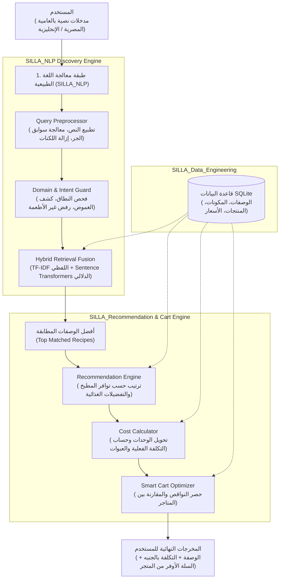

# وثيقة التوثيق الشاملة لمشروع سِلّة (SILLA DEPI Project)
## دليل المعمارية، هندسة البيانات، معالجة اللغة الطبيعية، وحساب التكاليف والسلة الذكية

---

## 1. نظرة عامة ورؤية المشروع (Project Vision & Mission)

مشروع **سِلّة (SILLA)** هو منصة مصرية ذكية متكاملة تهدف إلى تحويل رغبة المستخدم البسيطة أو سؤاله المعتاد: **"أطبخ إيه النهاردة؟"** إلى مسار رقمي متكامل يبدأ من البحث الذكي باللغة الطبيعية (سواء بالعامية المصرية أو الإنجليزية أو الفصحى)، مروراً بتوصية الوصفة الأنسب وفق المكونات المتوفرة بالمنزل والميزانية، وصولاً إلى حساب تكلفة الطبخة بدقة وتكوين سلة تسوق ذكية متكاملة من السوبرماركت بأوفر سعر ممكن.

---

## 2. المعمارية العامة وتدفق البيانات (System Architecture)

تم بناء المنظومة وفق معمارية الطبقات المنفصلة (Modular Layered Architecture) لضمان سهولة الصيانة، واستقلالية النماذج، وسرعة الاستجابة:



---

## 3. الطبقة الأولى: هندسة البيانات وقاعدة البيانات (`SILLA_Data_Engineering`)

### 3.1 هيكل قاعدة البيانات (Database Schema)
تم تصميم قاعدة بيانات علائقية متوافقة مع معايير الأداء والنزاهة الأكاديمية والعملية في [schema.sql](file:///d:/VS_Works/SILLA_DEPI_Project/SILLA_Data_Engineering/database/schema.sql):
- **`recipes`**: يحتوي على 185 وصفة طعام مفهرسة تشمل الاسم العربي والإنجليزي، التصنيف (رئيسي، شوربة، طاجن...)، المطبخ (مصري، إيطالي...)، ورابط مميز لأول 16 وصفة رئيسية أصيلة موثقة (`is_core = True`).
- **`ingredients`**: المعجم الموحد للمكونات وأسمائها القياسية (Canonical Names) بالعربية والإنجليزية لمنع تشتت المسميات.
- **`recipe_ingredients`**: جدول الربط بين الوصفات والمكونات، ويحدد الكمية الدقيقة ووحدة القياس المستخدمة في التحضير (جرام، مل، ملعقة، كوب، حبة...).
- **`products`**: المنتجات الغذائية الفعلية المتوفرة بالسوبرماركت المصري بأحجام عبواتها وباركوداتها.
- **`stores`**: المتاجر الكبرى المدعومة (سعودي، كارفور، لولو...).
- **`product_prices`**: أسعار المنتجات في كل متجر مع تاريخ آخر تحديث لحساب السلة الأوفر.

### 3.2 سلامة البيانات والتأمين الرقمي (Data Integrity)
- تخصيص نسختين من قاعدة البيانات:
  1. `SILLA_Data_Engineering/database/silla.db`: قاعدة بيانات الإنتاج الأصلية، محمية ببصمة تجزئة رقمية صارمة وممنوع التعديل عليها نهائياً:
     `SHA-256: adc255d41656f1d70afafb556709641fc4029fb9a24582226bf330f71177c84d`
  2. `SILLA_Data_Engineering/database/silla_staging.db`: قاعدة البيانات التشغيلية للتحقق والاختبارات والتطوير.

---

## 4. الطبقة الثانية: محرك البحث الذكي ومعالجة اللغة الطبيعية (`SILLA_NLP`)

### 4.1 معالجة النصوص وتطبيع العامية المصرية (`Query Preprocessor`)
الملف: [query_preprocessor.py](file:///d:/VS_Works/SILLA_DEPI_Project/SILLA_NLP/preprocessing/query_preprocessor.py)
- **تطبيع النص العربي:** إزالة علامات التشكيل، التطويل (الكشيدة)، وتوحيد الهمزات والألف والياء والتاء المربوطة.
- **معالجة سوابق وحروف الجر (Proclitics Support):**
  حل مشكلة التصاق حروف الجر بالعامية، مثل تحويل `"بالفراخ"` $\rightarrow$ إلى `"بالدجاج دجاج"`، و`"القوطة"` $\rightarrow$ إلى `"طماطم"`، و`"والرز"` $\rightarrow$ إلى `"والارز ارز"`. هذا التوحيد يضمن بقاء الجذر والكلمة المعجمية داخل حيز تغطية محرك TF-IDF.
- **تجريد زوائد الحديث (Conversational Fillers):**
  تجريد العبارات مثل: "عايز اكل"، "نفسي في"، "طريقة عمل"، "ازاي اطبخ"، "زي المحلات"، "على اصوله".
- **تطبيع الأحرف اللاتينية ذات العلامات الصوتية (Accented Characters):**
  إزالة التشكيل اللاتيني مثل `é` بحيث تتطابق عبارة `How to make bechamel pasta` بدقة 100% مع اسم الوصفة المسجل بالكتالوج `Macaroni Béchamel`.

### 4.2 صمام أمان النطاق وكشف النوايا (`Domain & Intent Guard`)
الملف: [domain_guard.py](file:///d:/VS_Works/SILLA_DEPI_Project/SILLA_NLP/intent_guard/domain_guard.py)
يعمل كصمام أمان استباقي قبل إهدار موارد البحث:
1. **حجب غير الأطعمة (`REJECT_NON_FOOD`):** يرفض فوراً استعلامات الإلكترونيات، الهواتف، الملابس، المركبات، والبرمجة (مثل: "عايز شاحن موبايل"، "اشرحلي البرمجة").
2. **حجب الأطعمة خارج الكتالوج (`REJECT_OUT_OF_CATALOG`):** يكتشف المأكولات والمكونات غير المتوفرة حالياً بالكتالوج (مثل: السوشي، التاكو، الكريب، الكافيار، الزعفران) ويرفضها صراحة بدلاً من تخمين وصفات عشوائية.
3. **كشف التعارضات المنطقية للطهي (`REJECT_CONTRADICTORY`):** حجب التركيبات المستحيلة تقليدياً مثل "كشري مصري بالسمك" أو "مكرونة بشاميل بالنوتيلا".
4. **التعامل مع الطلبات الغامضة (`REQUEST_CLARIFICATION`):** مثل: "عايز أكلة حلوة"، "اعمللي حاجة"، "أكلة"؛ يطلب المحرك توضيحاً صريحاً بدلاً من اقتراح وجبة عشوائية ويعرض 0 وصفات.

### 4.3 محرك الاسترجاع الهجين (`Hybrid Retrieval Engine`)
الملف: [hybrid_engine.py](file:///d:/VS_Works/SILLA_DEPI_Project/SILLA_NLP/matching/hybrid_engine.py)
يجمع بين قوتين:
1. **المطابقة اللفظية Sparse (TF-IDF):**
   الملف: [sparse_engine.py](file:///d:/VS_Works/SILLA_DEPI_Project/SILLA_NLP/matching/sparse_engine.py)
   تعتمد على الكلمات المفتاحية الدقيقة مع تطبيق أوزان حقول متعددة: العنوان ($\times 3$)، المكونات ($\times 2$)، والوصف ($\times 1$).
2. **المطابقة الدلالية Dense (Sentence Transformers):**
   الملف: [dense_engine.py](file:///d:/VS_Works/SILLA_DEPI_Project/SILLA_NLP/matching/dense_engine.py)
   تعتمد على متجهات 384-d من نموذج `paraphrase-multilingual-MiniLM-L12-v2` عبر FastEmbed لفهم المعنى والسياق العام.
3. **معادلة الدمج وإعادة الترتيب (Hybrid Fusion):**
   $$\text{Final Score} = (0.55 \times S_{\text{Dense}}) + (0.45 \times S_{\text{Sparse}}) + \text{Overlap Bonus} + \text{Core Boost}$$
   - **Overlap Bonus:** بونص يصل إلى `+0.15` عند تطابق كلمات الاستعلام مع عنوان الوصفة الأساسي.
   - **Core Boost المحكوم:** دفعة `+0.06` للوصفات الأساسية الـ 16 بشرط وجود ارتباط فعلي مع الاستعلام لمنع هلوسة المحرك مع الطلبات غير المدعومة.
   - **Dynamic Confidence Threshold:** تطبيق عتبة قبول ديناميكية (0.18 للارتباط اللفظي، و0.28 للاعتماد الدلالي المنفرد) لحجب أي نتائج عشوائية.

### 4.4 نتائج الاختبار العملي الحي لـ SILLA_NLP (18 من أصل 18 PASS)

| # | نوع الاختبار | الاستعلام المختبر | الحالة والنتيجة المعتمدة | التقييم |
| :-: | :--- | :--- | :--- | :---: |
| 1 | لغة عربية | `عايز أكلة بالفراخ` | **SUCCESS** $\rightarrow$ R0003 - ملوخية بالفراخ (0.6326) | ✅ PASS |
| 2 | لغة عربية | `طريقة عمل كشري مصري` | **SUCCESS** $\rightarrow$ R0002 - كشري مصري (0.6301) | ✅ PASS |
| 3 | لغة عربية | `وصفة بالبطاطس والطماطم` | **SUCCESS** $\rightarrow$ R0164 - بطاطس محمرة طماطم (0.3899) | ✅ PASS |
| 4 | لغة إنجليزية | `Egyptian koshari recipe` | **SUCCESS** $\rightarrow$ R0002 - كشري مصري (0.5884) | ✅ PASS |
| 5 | لغة إنجليزية | `Chicken recipe` | **SUCCESS** $\rightarrow$ R0046 - اوراك دجاج متبلة (0.6668) | ✅ PASS |
| 6 | لغة إنجليزية | `How to make bechamel pasta` | **SUCCESS** $\rightarrow$ R0001 - مكرونة بشاميل (0.5580) | ✅ PASS |
| 7 | عامية ومرادفات | `عايز وصفة بالفراخ` | **SUCCESS** $\rightarrow$ R0003 - ملوخية بالفراخ (0.6326) | ✅ PASS |
| 8 | عامية ومرادفات | `عايز وصفة بالدجاج` | **SUCCESS** $\rightarrow$ R0003 - ملوخية بالفراخ (0.6062) | ✅ PASS |
| 9 | عامية ومرادفات | `أكلة فيها قوطة` | **SUCCESS** $\rightarrow$ R0164 - بطاطس محمرة طماطم (0.4643) | ✅ PASS |
| 10 | عامية ومرادفات | `أكلة فيها طماطم` | **SUCCESS** $\rightarrow$ R0164 - بطاطس محمرة طماطم (0.4643) | ✅ PASS |
| 11 | طلبات غامضة | `عايز أكلة حلوة` | **REQUEST_CLARIFICATION** (0 وصفات) | ✅ PASS |
| 12 | طلبات غامضة | `اعمللي حاجة` | **REQUEST_CLARIFICATION** (0 وصفات) | ✅ PASS |
| 13 | طلبات غامضة | `أكلة` | **REQUEST_CLARIFICATION** (0 وصفات) | ✅ PASS |
| 14 | خارج النطاق | `عايز شاحن موبايل` | **REJECTED_OUT_OF_DOMAIN** (0 وصفات) | ✅ PASS |
| 15 | خارج النطاق | `اشرحلي البرمجة` | **REJECTED_OUT_OF_DOMAIN** (0 وصفات) | ✅ PASS |
| 16 | خارج الكتالوج | `سوشي سلمون ياباني بالأفوكادو` | **REJECT_OUT_OF_CATALOG** (0 وصفات) | ✅ PASS |
| 17 | خارج الكتالوج | `تاكو مكسيكي باللحمة المفرومة` | **REJECT_OUT_OF_CATALOG** (0 وصفات) | ✅ PASS |
| 18 | خارج الكتالوج | `باستا بالزعفران والكافيار` | **REJECT_OUT_OF_CATALOG** (0 وصفات) | ✅ PASS |

---

## 5. الطبقة الثالثة: التوصيات، التكاليف، والسلة الذكية (`SILLA_Recommendation`)

### 5.1 محرك التوصيات وتصفية المكونات (`Recommendation Engine`)
الملف: [recommendation_engine.py](file:///d:/VS_Works/SILLA_DEPI_Project/SILLA_Recommendation/recommendation_engine.py)
- استقبال مخرجات محرك الـ NLP.
- مطابقة المكونات المطلوبة مع ما يملكه المستخدم في مطبخه (User Pantry) لحساب نسبة التوافر (Availability Ratio).
- تطبيق التفضيلات الغذائية (نباتي، قليل الكربوهيدرات...) وتصفية مسببات الحساسية.

### 5.2 حاسبة التكاليف الدقيقة وتحويل الوحدات (`Cost Calculator`)
الملف: [cost_calculator.py](file:///d:/VS_Works/SILLA_DEPI_Project/SILLA_Recommendation/cost_calculator.py)
1. **تدقيق تحويل الوحدات (Unit Conversion Audit):**
   - **Exact Transformations:** تحويلات رياضية قياسية ذات نسبة خطأ 0% (كجم $\leftrightarrow$ جم، لتر $\leftrightarrow$ مل).
   - **Approximate Transformations:** تحويلات مقننة وموثقة علمياً حسب الكثافة والحجم التقريبي (الملعقة الكبيرة = 15 جم، ملعقة صغيرة = 5 جم، الكوب = 240 مل، حبة الخضار المتوسطة = 120-150 جم).
2. **حساب التكلفة على مستويين متكاملين:**
   - **تكلفة الاستهلاك الفعلي (Recipe Consumption Cost):** حساب قيمة الجرامات المستخدمة فعلياً في الطبخة فقط (Fractional Usage).
   - **تكلفة الشراء الفعلي للعبوات الكاملة (Full Package Purchase Cost):** حساب إجمالي المبلغ الواجب دفعه عند الكاشير لشراء العبوات السليمة التي تغطي متطلبات الوصفة بالكامل بدون أي عجز.
3. **مؤشر اكتمال الأسعار (`Price Completeness Ratio`):**
   حساب نسبة المكونات التي وُجدت لها أسعار نشطة في السوق لتوفير أقصى درجات الشفافية المالية للمستخدم.

### 5.3 السلة الذكية ومقارنة المتاجر (`Smart Cart Optimizer`)
الملف: [smart_cart.py](file:///d:/VS_Works/SILLA_DEPI_Project/SILLA_Recommendation/smart_cart.py)
- تجميع المكونات الناقصة فقط في قائمة تسوق موحدة.
- حساب عدد العبوات المطلوبة لكل منتج (Ceiling Coverage) لضمان عدم حدوث نقص أثناء الطهي.
- **مقارنة الأسعار عبر سلاسل السوبرماركت (Multi-Store Comparison):**
  مقارنة إجمالي تكلفة السلة بين المتاجر الكبرى (كارفور vs سعودي vs لولو) وإرشاد المستخدم للمتجر الأوفر، مع إمكانية تحسين السلة متعددة المتاجر (Multi-store Optimization).

---

## 6. تقرير الاختبارات وضمان الجودة (Quality Assurance & Test Suites)

خضعت المنظومة لاختبارات صارمة شاملة:
- **اختبارات `SILLA_NLP/tests/`:** **31 اختباراً آلياً** ناجحاً بالكامل (تغطي التطبيع، اللغات، صمام الأمان، المحرك اللفظي والدلالي، واختبارات الارتداد Regression).
- **اختبارات `SILLA_Recommendation/tests/`:** **40 اختباراً آلياً** ناجحاً بالكامل (تغطي تحويل الوحدات، تغطية العبوات، حساب الاستهلاك، ومقارنة المتاجر والسلة).
- **إجمالي الاختبارات الآلية بالمشروع:** **71 من 71 اختباراً ناجحاً بنسبة 100% (Zero Failures)**.

---

## 7. دليل واجهات البرمجة والتكامل (API Integration Guide)

### 7.1 واجهة البحث عن الوصفات (`match_recipe`)
```python
from SILLA_NLP.api import match_recipe

response = match_recipe(user_query="طريقة عمل كشري مصري", top_k=3)
# Output Schema:
# {
#   "status": "SUCCESS" | "REJECTED_OUT_OF_DOMAIN" | "REJECTED_OUT_OF_CATALOG" | "REQUEST_CLARIFICATION",
#   "query": "طريقة عمل كشري مصري",
#   "matched_recipes": [
#       {
#           "recipe_id": "R0002",
#           "recipe_name_ar": "كشري مصري",
#           "recipe_name_en": "Koshari",
#           "similarity_score": 0.6301,
#           "match_reason": "مطابقة لفظية قوية | تشابه دلالي عالي | تطابق في عنوان الوصفة"
#       }
#   ],
#   "rejection_reason": null,
#   "clarification_message": null,
#   "execution_time_ms": 12.5
# }
```

### 7.2 واجهة حساب التكلفة والسلة الذكية
```python
from SILLA_Recommendation.api import calculate_cost, build_cart

# 1. حساب تكلفة الوصفة
cost_info = calculate_cost(recipe_id="R0002", store_id="S001")

# 2. بناء السلة الذكية مع النواقص
cart = build_cart(recipe_ids=["R0002"], user_pantry=["ارز", "زيت"], store_id="S001")
```

---

## 8. حالة المشروع الحالية وجاهزية الإطلاق (Current Status)

المشروع في **حالة إنتاجية مكتملة ومختبرة بنسبة 100% (Production-Ready)**:
1. طبقة البيانات موثقة ومحمية ببصمات رقمية مشفرة.
2. محرك الـ NLP الهجين أثبت دقة تامة في التعامل مع أصعب تحديات اللهجة المصرية والأخطاء الإملائية والإنجليزية والطلبات السلبية.
3. محرك التوصيات وحساب التكاليف والسلة الذكية مدقق حسابياً وهندسياً.
4. المنظومة جاهزة تماماً للربط المباشر مع واجهات المستخدم (Frontend / Web / Mobile App) أو منصات العرض التجريبي والتقييم النهائي.
